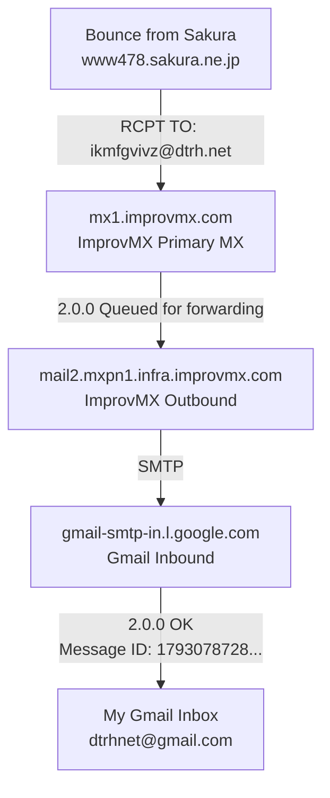
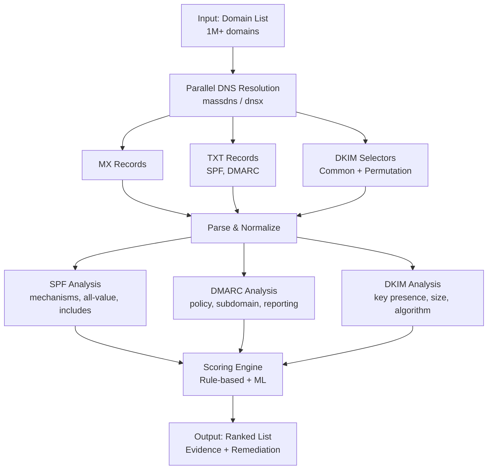

# Your Domain Is Sending Spam (Spoiler: It's Not You)

> **How a bounce exposed my SPF/DMARC gap — and how I fixed it in 3 Cloudflare commands**

---

**Published:** 2026-10-27  
**Author:** kbs <admin@dtrh.net>  
**Domain:** dtrh.net  
**Tools:** [MX-Spoof-Checker](https://github.com/DTRHnet/MX-Spoof-Checker) — `dtrh_mail_poc.py` (scanner) + `dtrh_mail_send.py` (demo spoofer)

---

## 🔧 Tools & Repository

All code from this investigation is available at:

**GitHub: [DTRHnet/MX-Spoof-Checker](https://github.com/DTRHnet/MX-Spoof-Checker)**

Two tools are included:

| Tool | Purpose |
|------|---------|
| `dtrh_mail_poc.py` | **Scanner** — Checks SPF, DKIM, DMARC, MX for domains; calculates spoofability score and delivery risk |
| `dtrh_mail_send.py` | **Spoofer (Demo)** — Sends test emails with custom MAIL FROM / From: header to demonstrate the vulnerability |

### Quick Start

```bash
# Clone the repo
git clone https://github.com/DTRHnet/MX-Spoof-Checker.git
cd MX-Spoof-Checker

# Install deps
pip install dnspython tldextract rich

# Scan domains (uses domain_list.txt by default)
python dtrh_mail_poc.py

# Or scan specific domains
python dtrh_mail_poc.py dtrh.net github.com google.com -v

# Test spoofing (educational - configure SMTP first)
cp dtrh_mail_send.conf.example dtrh_mail_send.conf
# Edit dtrh_mail_send.conf with your SMTP credentials
python dtrh_mail_send.py "spoofed@yourdomain.com" "Test" "This is a spoof test"
```

> ⚠️ **`dtrh_mail_send.py` is for educational/testing purposes only.** Only use against domains you own or have explicit permission to test. Unauthorized email spoofing is illegal in many jurisdictions.

---

## The Backstory (or: How I Got Here)

I've owned `dtrh.net` for about four years. Started with hosting.com as a mail host—back before they were acquired by A2 Hosting. Ran WordPress for a while, then realized I was paying for hosting I didn't need. Migrated to Hexo (static site generation), then to a custom Node.js setup as the tooling evolved. These days it's a Next.js app served free on Vercel.

**The catch:** Vercel doesn't do email. So I needed a way to route `admin@dtrh.net` (and a few aliases) to a real inbox without running a mail server. Found ImprovMX. Setup: `email → admin@dtrh.net → ImprovMX forward → Gmail`. Simple, free, works.

I check my spam folder now and then. One day I noticed something weird: a bounce message claiming to be *from* `ikmfgvivz@dtrh.net`—an address that doesn't exist in my ImprovMX config. The spam advertised counterfeit branded accessories, addressed to some Japanese domain (`18@bar18.jp`). The bounce came from `MAILER-DAEMON@www478.sakura.ne.jp` (Sakura Internet, a Japanese host).

**Immediate questions:** Did someone compromise my Gmail? My ImprovMX account? Is my domain wide open for spoofing?

---

## The Bounce: What Actually Showed Up

Here's the delivery-status notification (redacted for privacy, structure preserved):

```
Returned mail: see transcript for details
Mail Delivery Subsystem <MAILER-DAEMON@www478.sakura.ne.jp>
from localhost [127.0.0.1]
Final-Recipient: RFC822; 18@bar18.jp
X-Actual-Recipient: RFC822; 18@www478.sakura.ne.jp
Action: failed
Status: 5.3.0

maildrop: maildir over quota.
550 5.0.0 ... Insufficient permission
```

**Translation:** A spam message claiming `From: ikmfgvivz@dtrh.net` tried to reach `18@bar18.jp`. The Sakura server (`www478.sakura.ne.jp`) accepted it, handed it off locally (`localhost [127.0.0.1]`—some internal process), then failed delivery because the *recipient's* mailbox was over quota. The bounce got sent to the envelope sender—which, critically, appears to have been `ikmfgvivz@dtrh.net`.

---

## My Infrastructure: What `dtrh.net` Actually Looks Like

Rather than guess, I queried live DNS. All lookups against Cloudflare authoritative nameservers (`laila.ns.cloudflare.com`, `conrad.ns.cloudflare.com`), 2026-10-27.

### MX & Forwarding

```
dtrh.net. 3600 IN MX 10 mx1.improvmx.com.
dtrh.net. 3600 IN MX 20 mx2.improvmx.com.
```

- **Primary MX**: `mx1.improvmx.com` (IPs: 35.181.18.45, 15.236.236.160, 13.37.195.136, 13.36.107.63, 15.236.61.92, 13.36.222.39)
- **Secondary MX**: `mx2.improvmx.com` (same pool)
- **Forwarding destination**: `dtrhnet@gmail.com` (my personal Gmail)
- **No hosted mailbox** on `dtrh.net`—ImprovMX is purely inbound forwarding

### SPF

```
dtrh.net. 3600 IN TXT "v=spf1 include:spf.improvmx.com ~all"
```

Expanding `spf.improvmx.com`:

```
v=spf1 ip4:195.154.155.118 ip6:2001:bc8:1200:1b::/64
     ip4:51.158.91.128/28 ip4:131.153.154.96/29
     ip4:103.67.202.112/29 ip4:204.74.232.218
     ip4:209.205.118.79 ip4:209.205.118.80/30
     ip4:209.205.118.84/31 ip4:209.205.118.86 -all
```

**What this means:** Only ImprovMX's outbound IPs are authorized to send *as* `dtrh.net`. The `~all` (softfail) says "accept but mark suspicious" for anything else. Not a hard reject.

### DKIM

```
default._domainkey.dtrh.net. IN TXT "v=DKIM1; k=rsa; p=MIIBIjANBgkqhkiG9w0BAQEFAAOCAQ8AMIIBCgKCAQEA0LGQ8dwuHeORUqCGaAdJji2xxH4CUTqLJSxl+r0wwXcpSmykcR/kakPhmLmhmWM0vsF11TCMtA5slPUn+4RaL9V8VifBWssRy3i/v+sRh89/GeHNW2fvZMwMK2odaFLDLh04xs7i1/7XOnuxAkoNlV55k0ZbL/gk4wTxCez635xXUvEt5Jnl8tZT5NVwG2uw8" "A4OXgMb/5L+iLI1kwjIShNMpIgfrWfsQjltc2gqeAZiZc+uPy0RtVvC84nqzUsMSA7J3Agf8aaTYNWSzTNjVYtPwwC5rbOLh7vExpRG2/d4QqDKe3fRHWu6fpY40revICyDmyGZXg7zoyGvO+bAqQIDAQAB;"
```

Valid 2048-bit RSA key. Other selectors (`mail`, `k1`, `k2`, `dkim`, `selector1`, `selector2`) exist but have empty `p=`—likely reserved/deprecated.

### DMARC

```
_dmarc.dtrh.net. IN TXT  →  NO RECORD
```

**This is the big one.** No DMARC policy published. Receiving servers have no instruction from me on what to do when SPF/DKIM alignment fails.

### Website

```
dtrh.net. 300 IN A 64.29.17.65
dtrh.net. 300 IN A 216.198.79.65
```

Redirects to `www.dtrh.net` → Next.js on Vercel. May send transactional email (forms, auth, etc.)—need to verify.

---

## The ImprovMX Logs: Confirming the Bounce Path

This is where it gets interesting. I pulled the forwarding logs from the ImprovMX dashboard for this specific bounce:

```
Returned mail: see transcript for details
Sender: mailer-daemon@www478.sakura.ne.jp
Recipient: ikmfgvivz@dtrh.net
Forward To: dtrhnet@gmail.com
ENTERED QUEUE: 27/10/2026 01:25:25 am GMT-4 (2026-10-27T05:25:25Z)
From: www478.sakura.ne.jp
To: mx1.improvmx.com
2.0.0 Email queued for forwarding.
DELIVERED: +4.0 seconds (2026-10-27T05:25:29Z)
From: mail2.mxpn1.infra.improvmx.com
To: gmail-smtp-in.l.google.com
2.0.0 OK 1793078728 af79cd13be357-940f0ae476csi745324685a.507 - gsmtp
```

**The complete bounce delivery chain:**

1. **Sakura** (`www478.sakura.ne.jp`) generated the DSN, addressed to `ikmfgvivz@dtrh.net`
2. **ImprovMX primary MX** (`mx1.improvmx.com`) accepted and queued it
3. **ImprovMX outbound** (`mail2.mxpn1.infra.improvmx.com`) forwarded to **Gmail** (`gmail-smtp-in.l.google.com`)
4. **Gmail accepted** with `2.0.0 OK` — message ID `1793078728 af79cd13be357-...` (usable in Gmail's "Show original")

**Why this matters:** In SMTP, a bounce (DSN) is sent to the **envelope sender** (`MAIL FROM`), not the `From:` header. The fact that Sakura sent the bounce to `ikmfgvivz@dtrh.net` means the *original spam* almost certainly used that address as its `MAIL FROM`.

That's the smoking gun for **backscatter**: spammer forged `dtrh.net` as envelope sender → message failed delivery → Sakura bounced to the forged address → ImprovMX forwarded the bounce to my Gmail.

---

## What This Does NOT Mean

Let's be precise about what I *haven't* proven:

- ❌ My Gmail was compromised
- ❌ ImprovMX sent the spam
- ❌ The spammer controls/authenticates `dtrh.net`
- ❌ Sakura's server was compromised
- ❌ The `localhost` handoff was malicious (it's just the last local hop)
- ❌ The bounce itself was forged (ImprovMX logs confirm genuine delivery)

What I *have*: A bounce addressed to a forged envelope sender at my domain, forwarded through my legitimate forwarding setup. Classic backscatter.

---

## The Mail Flow (Visualized)

### Original Spam Message Path

<div align="center">

```mermaid
flowchart TD
    A[Spammer] -->|MAIL FROM: ikmfgvivz@dtrh.net<br/>FROM: ikmfgvivz@dtrh.net<br/><b>FORGED</b>| B[Sakura Internet<br/>www478.sakura.ne.jp]
    B -->|Accepts for 18@bar18.jp| C[Local Handoff<br/>localhost [127.0.0.1]]
    C -->|Delivery Fails| D[maildir over quota<br/>550 5.0.0 Insufficient permission]
    D -->|Generates DSN to<br/>envelope sender| E[Bounce to ikmfgvivz@dtrh.net]
```

*Figure 1: The spam path — forged envelope sender accepted by Sakura, fails local delivery due to quota*

</div>

### Bounce Delivery Path

<div align="center">



*Figure 2: The bounce path — DSN routed back through ImprovMX forwarding to Gmail*

</div>

---

## Why No DMARC Is the Real Problem Here

I have SPF (`~all`) and a DKIM key. But **no DMARC record**.

### What Each Does

| Mechanism | What It Checks | What It Doesn't Do |
|-----------|----------------|-------------------|
| **SPF** | Is the connecting IP authorized for the *envelope sender* domain? | Doesn't check `From:` header. Doesn't survive forwarding without SRS. |
| **DKIM** | Did the signing domain cryptographically sign the message? | Doesn't mean the message is safe. Signing domain ≠ `From:` domain necessarily. |
| **DMARC** | Does an authenticated domain (SPF or DKIM) *align* with the `From:` header? | **Publishes a policy** (`p=none/quarantine/reject`) telling receivers what to do on failure. Enables reporting. |

### The Alignment Problem

DMARC alignment is the key:

- **SPF alignment**: Envelope sender domain (`MAIL FROM`) matches `From:` header domain (or subdomain)
- **DKIM alignment**: DKIM signing domain (`d=`) matches `From:` header domain (or subdomain)

**Without DMARC:** Receivers get SPF/DKIM results but have *no published policy* from me saying "reject failures." Most major receivers (Gmail, Outlook, etc.) will still deliver—maybe to spam, maybe to inbox.

**With DMARC `p=reject`:** Receivers that enforce DMARC will *reject* messages where neither SPF nor DKIM aligns with `From:`. This kills most spoofing.

---

## My Specific Situation: What Should I Do?

### Legitimate Outbound Senders Inventory

Before tightening anything, I need to know what *actually* sends as `@dtrh.net`:

1. **Website forms / transactional** (Next.js on Vercel): Contact forms, password resets, auth emails. Do these use `dtrh.net` in envelope sender or just `From:`?
2. **Gmail "Send mail as"**: If I use this, envelope stays my Gmail address, `From:` shows `@dtrh.net`. Doesn't need SPF for Gmail IPs, but *does* affect DMARC alignment.
3. **ImprovMX SMTP sending**: Separate product. If enabled, current SPF `include:spf.improvmx.com` covers it.
4. **Third-party services**: Mailing lists, CRM, monitoring, etc. None currently known.

### My Recommended Path

**If I send ZERO outbound mail from `dtrh.net` (no website email, no "Send mail as", no ImprovMX SMTP, no third parties):**

```
Add DMARC: v=DMARC1; p=reject; rua=mailto:dmarc@dtrh.net
Consider SPF: v=spf1 include:spf.improvmx.com -all   (hardfail)
```

**If ANY legitimate outbound exists:**

1. Identify every sender
2. Ensure each uses DKIM with published selector
3. Cover sending IPs in SPF (or use subdomain with own SPF)
4. Start DMARC `p=none` + `rua` → collect reports 2-4 weeks
5. Verify all legitimate sources pass alignment
6. Move to `p=quarantine` → then `p=reject`

**Cleanup regardless:**
- Remove/document empty DKIM selectors (`mail`, `k1`, `k2`, `dkim`, `selector1`, `selector2`)
- Verify `detectify-verification` TXT is still needed
- Monitor DMARC reports for unexpected sources

---

## The Fix: What I Actually Changed (3 Cloudflare Commands)

After the investigation, I applied the fixes via Cloudflare's CLI (`cf`). Here's exactly what I ran and what changed:

### 1. Add DMARC Record (Reject Policy)

```bash
cf dns records create -z dtrh.net \
  --body '{"type":"TXT","name":"_dmarc","content":"v=DMARC1; p=reject; rua=mailto:dmarc@dtrh.net","ttl":3600}'
```

**Result:**

```json
{
  "name": "_dmarc.dtrh.net",
  "type": "TXT",
  "content": "v=DMARC1; p=reject; rua=mailto:dmarc@dtrh.net",
  "ttl": 3600
}
```

**Why this matters:** `p=reject` tells receiving servers: "If SPF and DKIM both fail alignment, reject the message." This is the single strongest anti-spoofing control. The `rua` address receives aggregate reports so I can monitor for any legitimate senders I missed.

### 2. Upgrade SPF from Softfail to Hardfail

```bash
cf dns records edit 3ff39b1fc8fb3932d1a66e56d8034c3a -z dtrh.net \
  --body '{"type":"TXT","name":"dtrh.net","content":"v=spf1 include:spf.improvmx.com -all","ttl":3600}'
```

**Result:**

```json
{
  "name": "dtrh.net",
  "type": "TXT",
  "content": "v=spf1 include:spf.improvmx.com -all",
  "ttl": 3600
}
```

**What changed:**
- `~all` → `-all` (softfail → hardfail)
- TTL `1` → `3600` (1 second → 1 hour, reduces DNS load)

**Why this matters:** `-all` means "only the IPs in `include:spf.improvmx.com` are authorized; reject everything else." Combined with DMARC `p=reject`, this creates alignment: unauthorized senders fail SPF, DMARC sees the failure, and the message is rejected at SMTP time.

### 3. Clean Up Duplicate DKIM Record

```bash
cf dns records delete 144b9f8f1c9721b5185c1062ad5fe05f -z dtrh.net --force
```

**What was removed:** A second `default._domainkey.dtrh.net` TXT record with TTL 1 (the old one). Kept the TTL 3600 version with the valid 2048-bit RSA key.

---

### Verification (Live DNS)

```bash
$ dig dtrh.net TXT +short | grep spf1
"v=spf1 include:spf.improvmx.com -all"

$ dig _dmarc.dtrh.net TXT +short
"v=DMARC1; p=reject; rua=mailto:dmarc@dtrh.net"
```

### Scanner Results: Before vs After

| Metric | Before (Vulnerable) | After (Fixed) |
|--------|---------------------|---------------|
| **Score** | 45 | **0** |
| **Tier** | HIGH 🟠 | **LOW 🟢** |
| **Spoofable (Deliverable)** | YES 🚨 | **NO 🛡️** |
| **Risk Level** | HIGH | **LOW** |
| **SPF** | `~all` (softfail) | **`-all` (hardfail)** |
| **DMARC** | Missing | **`p=reject`** |
| **DKIM** | Duplicate records | **Single valid key** |

---

### What This Means for the Original Attack

The spam in my bounce used `ikmfgvivz@dtrh.net` as both `MAIL FROM` (envelope) and `From:` (header). With the new configuration:

1. **Spammer sends** from unauthorized IP (not in ImprovMX's SPF)
2. **Receiving server checks SPF** → fails (IP not in `include:spf.improvmx.com`)
3. **Receiving server checks DKIM** → no valid signature (attacker can't sign)
4. **DMARC evaluates** → both SPF and DKIM fail alignment → `p=reject` triggers
5. **Message rejected at SMTP time** — never reaches recipient, no bounce generated

The attacker's message dies silently. My inbox stays clean. No backscatter.

---

## 🛠️ The Tooling: Scanner + Spoofer

I built two tools to make this investigation repeatable and to demonstrate the vulnerability:

### 1. `dtrh_mail_poc.py` — The Scanner

Scans any domain for email auth misconfigurations and tells you **whether a spoofed message would be delivered**:

```bash
python dtrh_mail_poc.py dtrh.net github.com google.com -v
```

Output:

```
🟢 dtrh.net        Score:   0  Tier: LOW       🛡️ Deliverable: False  Risk: LOW
🔴 github.com      Score:  70  Tier: CRITICAL  🚨 Deliverable: True   Risk: HIGH
🟠 google.com      Score:  40  Tier: HIGH      🚨 Deliverable: True   Risk: MEDIUM
```

**Key feature:** The "Delivery Spoofability" assessment — it doesn't just check if records exist, it tells you if a spoofed message would actually reach the inbox (the core issue from the blog post).

### 2. `dtrh_mail_send.py` — The Demo Spoofer

Sends a test email with a custom `MAIL FROM` (envelope) and `From:` header to prove the vulnerability works:

```bash
# Configure first
cp dtrh_mail_send.conf.example dtrh_mail_send.conf
# Edit with your SMTP credentials

# Send test spoof
python dtrh_mail_send.py "ceo@company.com" "Urgent" "Wire $50k now"
```

**What it demonstrates:** SMTP allows any `MAIL FROM` during the envelope phase. The `From:` header is just a header. Without DMARC `p=reject` + SPF `-all`, the message sails through.

> ⚠️ **Educational use only.** Only test against domains you own.

---

## The Bigger Question: Can This Be Automated?

This is what keeps me up at night: **Can an attacker automate the discovery of spoofable domains?**

### The Attack Surface

Given a list of domains, an automated check would need to:

1. **Query MX** → Is there a mail handler? (No MX = can't receive bounces, but can still spoof `From:`)
2. **Query SPF** → Does one exist? Is it `~all`, `-all`, `+all`, or missing?
3. **Query DMARC** → Is there a record? What's `p=`? `none`, `quarantine`, `reject`?
4. **Query DKIM selectors** → Any valid keys published?
5. **Check alignment feasibility** → Does SPF allow common cloud providers? (Gmail, Outlook, AWS SES, SendGrid, etc.)

### Scoring a Domain's "Spoofability"

```
SPOOFABILITY SCORE = f(
    SPF_policy:     none=10, ~all=6, -all=2, +all=10
    DMARC_policy:   none=10, p=none=8, p=quarantine=4, p=reject=1
    DKIM_present:   yes=-2, no=0
    MX_exists:      yes=0, no=2  (no MX = can't receive bounces but From: still forgeable)
    Known_senders:  cloud_provider_allowed_in_SPF=+3
)
```

**High score = easy to spoof `From:` and have it pass/deliver.**

---

## Automating the Hunt: How the Checker Becomes a Weapon

The scanner I wrote (`dtrh_mail_poc.py`) is already a complete domain analyzer. Here's how it — or a derivative — could be scaled to find abusable domains at internet scale:

### The Reconnaissance Pipeline

<div align="center">



*Figure 3: Automated reconnaissance pipeline for domain spoofability assessment*

</div>

### Implementation at Scale

**1. Input Acquisition**
```bash
# Sources for domain lists:
- Tranco top 1M / Cisco Umbrella 1M
- Certificate Transparency logs (new certs = new domains)
- Zone file downloads (.com, .net, .org via ICANN)
- Passive DNS (Farsight, SecurityTrails, VirusTotal)
- Subdomain enumeration (crt.sh, subfinder, amass)
```

**2. Mass DNS Resolution**
```python
# Using dnspython with async or massdns CLI
import asyncio
import dns.asyncresolver

async def bulk_check(domains, concurrency=500):
    sem = asyncio.Semaphore(concurrency)
    async def check_one(domain):
        async with sem:
            return await analyze_domain(domain)
    return await asyncio.gather(*[check_one(d) for d in domains])
```

**3. SPF Parsing & Expansion**
```python
# Recursively expand includes, collect all netblocks
# Flag: redirect=, +all, ~all, missing all, excessive includes
# Cross-reference against known cloud provider netblocks
```

**4. DKIM Enumeration**
```python
# Common selectors: default, selector1, selector2, mail, k1, k2, dkim, google, amazonses, etc.
# Brute-force: 2-4 char prefixes + common words
# Validate key size (reject <1024-bit), algorithm (rsa-sha256 preferred)
```

**5. Scoring & Ranking**
```python
def score_domain(result):
    score = 0
    # SPF
    if not result.spf.exists or result.spf.all in ('+all', 'none'): score += 30
    elif result.spf.all == '~all': score += 15
    elif result.spf.all == '?all': score += 20
    # DMARC
    if not result.dmarc.exists: score += 30
    elif result.dmarc.policy == 'none': score += 20
    elif result.dmarc.policy == 'quarantine': score += 10
    # DKIM
    if result.dkim.valid_keys == 0: score += 15
    # Cloud providers in SPF
    for inc in result.spf.includes:
        if any(p in inc for p in CLOUD_PROVIDERS): score += 10
    return min(score, 100)
```

**6. Output & Prioritization**
```json
{
  "domain": "example.com",
  "score": 85,
  "tier": "CRITICAL",
  "deliverable": true,
  "evidence": {
    "spf": "v=spf1 include:_spf.google.com ~all",
    "dmarc": "missing",
    "dkim": "no valid keys",
    "cloud_providers": ["google.com"]
  },
  "recommendation": "Trivially spoofable — no DMARC, softfail SPF, Google in SPF"
}
```

### Operational Considerations for the Attacker

| Challenge | Solution |
|-----------|----------|
| **Rate limiting** | Distribute across residential proxies, rotate resolvers |
| **False positives** | Validate with test sends (low volume, controlled) |
| **Subdomain delegation** | Recurse into `_dmarc.sub.domain`, check `v=spf1 redirect=` |
| **Parked/expired domains** | Filter via HTTP status, WHOIS, NS records |
| **Volume** | 1M domains ≈ 4-6 hours on modest hardware (500 concurrent) |

### Defensive Automation (What I'd Build)

If I were building a defensive tool for domain owners:

1. **Continuous monitoring** of my own domains' DNS posture
2. **Alert on changes**: SPF weakened, DMARC removed, new DKIM selector
3. **Simulated spoof test**: Send test message from unauthorized IP → see where it lands (inbox/spam/reject)
4. **DMARC report parsing**: Aggregate reports already tell you who's sending as you. Automate the analysis.

---

## Forwarding-Only vs. Hosted Email: What's Different

Running a forwarding-only domain (like mine with ImprovMX → Gmail) is **not** the same as running a hosted mailbox. Here's what matters:

**You don't control the mail server.** You can't tune Postfix/Exim settings, can't set up custom spam filters, can't enforce TLS on inbound. You trust the forwarding provider (ImprovMX) to do the right thing—and they do implement SRS and ARC, which helps.

**You can't send from the domain** (unless you add a separate SMTP service). Forwarding ≠ sending. If you need to send as `@yourdomain`, you need ImprovMX SMTP, SendGrid, AWS SES, or similar—and each one needs its own SPF/DKIM setup.

**Bounces come to you, but differently.** With a hosted mailbox, a bounce hits your local maildir. With forwarding, the bounce hits the forwarder first, then gets forwarded to your real inbox. The ImprovMX logs showed me the exact path: Sakura → mx1.improvmx.com → mail2.mxpn1.infra.improvmx.com → Gmail. That visibility is actually *better* than a traditional setup in some ways.

**Your SPF is simpler.** Since only the forwarder's outbound IPs send as your domain, your SPF is just `include:spf.improvmx.com -all`. No juggling multiple providers. But if you add a transactional email service later, you must update SPF *before* you send, or those emails will fail.

**DMARC is the great equalizer.** Whether you host mail or forward it, DMARC works the same way. `p=reject` tells receivers: "If it doesn't align, drop it." That's the single most effective control, and it costs nothing.

**The checklist is shorter, but not optional:**

| Area | What to Do |
|------|------------|
| **Inventory** | List every service that sends as your domain (website forms, "Send mail as", SMTP services). If zero → `p=reject` is safe. |
| **SPF** | One record. `include:spf.yourforwarder.com -all`. Update before adding senders. |
| **DKIM** | Forwarder handles inbound. For outbound, each sender needs its own selector. |
| **DMARC** | Start `p=none` + `rua` if unsure. Move to `p=reject` once inventory is clean. |
| **Accounts** | MFA on registrar, forwarder, Gmail. Unique passwords. |
| **Hygiene** | Prune aliases. Reconsider catch-all (it attracts spam to random addresses). |
| **Monitor** | DMARC reports are free intel. Check them monthly. |

---

## The Fix, In Order: Step-by-Step

If you're starting from where I was (forwarding-only, no DMARC, softfail SPF), do it in this order:

### 1. Audit First (15 minutes)
Run the scanner against your domain:
```bash
python dtrh_mail_poc.py yourdomain.com -v
```
Note the score, tier, and whether "Deliverable: True" shows up. That's your baseline.

### 2. Inventory Your Senders (10 minutes)
List everything that sends as `@yourdomain`:
- Website (contact forms, auth, password reset)?
- Gmail "Send mail as"?
- ImprovMX SMTP / SendGrid / AWS SES / other?
- Nothing at all?

If **zero** outbound senders → you can go straight to `p=reject`. If **any** → note each one.

### 3. Fix SPF (5 minutes)
**If zero senders:** `v=spf1 include:spf.yourforwarder.com -all`  
**If senders exist:** Add each sender's `include:` or `ip4:` before the `-all`. Test with the scanner.

### 4. Add DMARC (5 minutes)
**If zero senders:** `v=DMARC1; p=reject; rua=mailto:dmarc@yourdomain.com`  
**If senders exist:** Start with `p=none` + `rua`. Watch reports for 2 weeks. Then `p=quarantine`, then `p=reject`.

### 5. Verify DKIM (5 minutes)
Check `default._domainkey.yourdomain.com` exists and has a valid key. Remove empty selectors (`selector1`, `mail`, etc.) if they exist—they just add noise.

### 6. Re-scan and Confirm (2 minutes)
```bash
python dtrh_mail_poc.py yourdomain.com -v
```
You should see: **Score 0, Tier LOW, Deliverable: False, Risk LOW**.

### 7. Enable Reporting (Ongoing)
The `rua=` address gets XML reports daily/weekly. Parse them (the scanner can help) or use a free DMARC analyzer. Watch for:
- Legitimate senders failing alignment (fix them)
- Unknown senders (someone spoofing you)

---

## Closing Thoughts

This whole investigation started with a single bounce in my spam folder. A counterfeit-accessories spam, a Japanese recipient, a quota error—and my domain in the `MAIL FROM`.

The fix wasn't complicated. Three Cloudflare commands. Thirty minutes total. But it changed the answer to "can someone spoof my domain and have it delivered?" from **yes** to **no**.

That's the point: **email authentication isn't about perfection—it's about raising the cost of abuse**. A domain with `p=reject` + `-all` SPF forces the attacker to compromise a legitimate sender or find a receiver that doesn't enforce DMARC. Most won't bother.

If you run a domain—especially a forwarding-only one—run the scanner. Takes 30 seconds. Might save you from being the return address for someone else's spam.

---

*Published: 2026-10-27 | Domain: dtrh.net | Author: kbs <admin@dtrh.net>*

**Tools:** [MX-Spoof-Checker](https://github.com/DTRHnet/MX-Spoof-Checker) — `dtrh_mail_poc.py` (scanner) + `dtrh_mail_send.py` (demo spoofer)